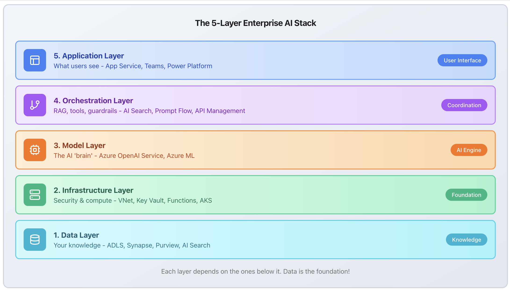

5 Layer AI

Key Points

1. Data Layer: Where your enterprise knowledge lives (ADLS, Synapse, Purview, AI Search)
2. Infrastructure Layer: The secure foundation (VNet, Private Link, Key Vault, Functions)
3. Model Layer: The AI 'brain' (Azure OpenAI Service, Azure ML)
4. Orchestration Layer: The coordinator (AI Search vectors, Prompt Flow, API Management)
5. Application Layer: What users actually see (App Service, Teams, Power Platform)

https://azurekt.com/enterprise-genai
