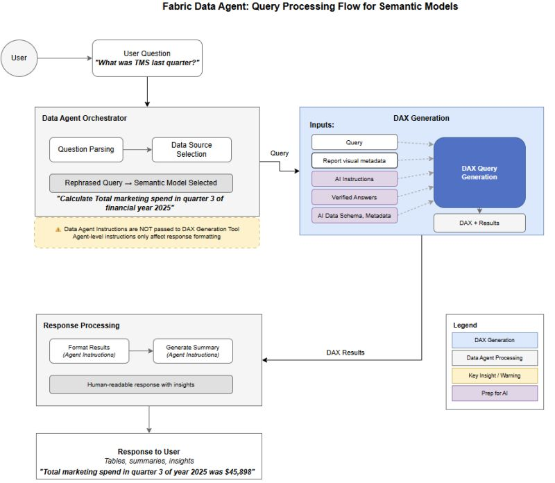

Data Agent

## Concepts

Data isn't the hard part. 
Understanding each other is.

Ontology. Lineage. Semantic layers. Vector databases.

I've been in data for over 15 years, and sometimes even I feel like I'm decoding a foreign language. 
We've turned simple ideas into jargon that makes non-data people tune out.

Here's what these terms actually mean and why they matter for AI:

▶️ Ontology 
A shared definition of your core business concepts and how they relate. 
It gives AI clear concepts to reason about instead of guessing.

▶️ Entity 
A real world thing like a customer, product or event. 
It helps AI tell the difference between people, products and moments in time.

▶️ Metadata 
Data that explains other data. 
It tells AI what something means, how fresh it is and whether it can be trusted.

▶️ Physical layer 
Where data is stored and processed. 
It shapes how fast, scalable and reliable AI workloads can be.

▶️ Logical layer 
How data is organised conceptually, not physically. 
It shields AI from raw technical mess.

▶️ Semantic layer 
A business friendly layer with agreed definitions and metrics. 
It stops humans and AI arguing over what a number actually means.

▶️ Schema 
The formal structure of what data exists and what type it is. 
It gives consistency so AI knows what to expect.

▶️ Data modelling 
How entities and their relationships are designed. 
It reduces confusion in how AI interprets data.

▶️ Data virtualisation 
Accessing data from many sources without copying it all. 
It lets AI work across systems seamlessly.

▶️ Vector database 
A database that searches by similarity, not exact matches. 
It enables richer retrieval and context for AI.

▶️ Data pipeline 
How data flows from creation to consumption. 
It keeps AI fed with timely and relevant inputs.

▶️ Orchestration 
Coordinating when and how pipelines run. 
It keeps jobs reliable and in the right order.

▶️ Data quality 
How accurate, complete and consistent the data is. 
It directly affects confidence in AI outputs.

▶️ Observability 
Seeing what data systems are doing and spotting issues early. 
It helps catch drift and weird behaviour before damage is done.

▶️ Data lineage 
Where data comes from, how it changes and where it’s used. 
It adds transparency and explainability to AI decisions.

None of this is magic. 
But together, it’s the foundation AI stands on.

## Query flow

he first times I tested Microsoft Fabric Data Agents on top of a Power BI semantic model, the pattern was predictable:

🤔 Someone asks a simple question, and it works.
😅 Then they rephrase it (or use a business synonym), and the agent suddenly picks a different measure or returns something that looks reasonable but is not what the team means.

🛠️ My instinct was to "fix the agent" with better instructions.

📌 Microsoft has now made the guidance explicit for semantic models: for DAX generation, the data agent relies on the semantic model metadata plus "Prep for AI" configuration (and it ignores instructions added at the data agent level for DAX query generation).

✅ So the real work is in the model.

🧩 What I'm taking into projects now:

• Prep for AI (in the semantic model), not prompt tweaks
 ▸ AI data schema: limit what the agent can use so it stops guessing between overlapping measures
 ▸ Verified answers: anchor common questions to a known-good visual/query shape
 ▸ AI instructions: define business terms and metric preferences where the DAX tool can actually read them

• Reduce ambiguity
 ▸ business-friendly names
 ▸ fewer helper/duplicate measures in scope

• Test like an engineer
 ▸ look at the generated DAX
 ▸ iterate based on what it actually did, not what we hoped it would do

🚀 If you are experimenting with Data Agents on semantic models, this is worth a read because it shifts effort from "agent prompt craft" to "semantic model readiness".

Reference: https://learn.microsoft.com/en-us/fabric/data-science/semantic-model-best-practices

