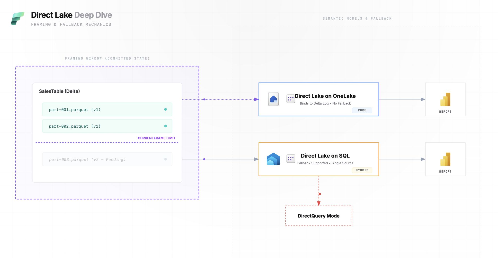

# Direct Lake

## Direct Lake vs Direct Query

SUMMARY: It is worth to mention that **Directlake is not recommended** unless for one user to do some quick analysis. The reason is that it full loads tables into in-memory cache for each user and consumes PowerBI resources each time a user open the report. be aware.

𝗗𝗶𝗿𝗲𝗰𝘁 𝗟𝗮𝗸𝗲 𝗙𝗮𝗹𝗹𝗯𝗮𝗰𝗸 𝗠𝗲𝗰𝗵𝗮𝗻𝗶𝘀𝗺 𝗪𝗵𝗮𝘁 𝗬𝗼𝘂 𝗥𝗲𝗮𝗹𝗹𝘆 𝗡𝗲𝗲𝗱 𝘁𝗼 𝗨𝗻𝗱𝗲𝗿𝘀𝘁𝗮𝗻𝗱

I’ve been digging deeper into Direct Lake lately, and one of the most critical (and often misunderstood) topics is the fallback mechanism.

If you’re designing semantic models in Microsoft Fabric, understanding when and why Direct Lake falls back can save you from unexpected performance and governance issues.

Here’s the key distinction:

𝗗𝗶𝗿𝗲𝗰𝘁 𝗟𝗮𝗸𝗲 𝗼𝗻 𝗢𝗻𝗲𝗟𝗮𝗸𝗲
• Can read Delta tables from one or more Fabric data sources
• No fallback to DirectQuery via SQL analytics endpoints
• You can mix in Import tables from other sources
• Designed for maximum performance and engine-level access to data
• Currently Public Preview (tenant setting required)

In short: once you’re in Direct Lake on OneLake, you stay there.

𝗗𝗶𝗿𝗲𝗰𝘁 𝗟𝗮𝗸𝗲 𝗼𝗻 𝗦𝗤𝗟
• Uses a single Fabric data source
• Relies on the SQL analytics endpoint for table discovery and permissions
• Falls back to DirectQuery when:
– The source is a SQL View
– The Warehouse uses SQL-based granular security
– Data can’t be read directly from Delta files
• Fallback behavior is controlled by the Direct Lake behavior property

This means your semantic model can silently switch execution modes depending on how the data is exposed.

𝗪𝗵𝘆 𝘁𝗵𝗶𝘀 𝗺𝗮𝘁𝘁𝗲𝗿𝘀
• Performance expectations can change instantly
• Security design directly impacts query mode
• SQL views ≠ Delta tables (from Direct Lake’s perspective)
• Architecture decisions at the storage layer affect BI behavior

Direct Lake isn’t just a storage mode it’s an architecture choice.

If you’re aiming for predictable performance and minimal surprises, you must be intentional about OneLake vs SQL endpoints, Delta vs views, and security models.

