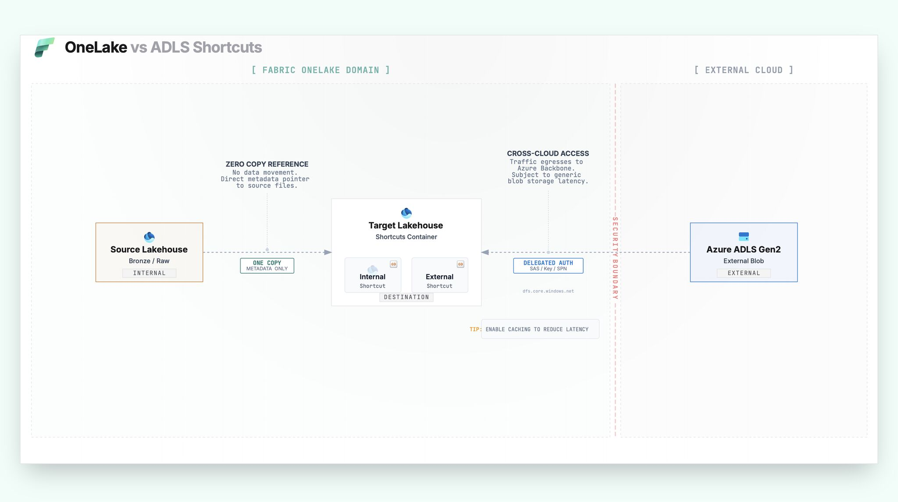
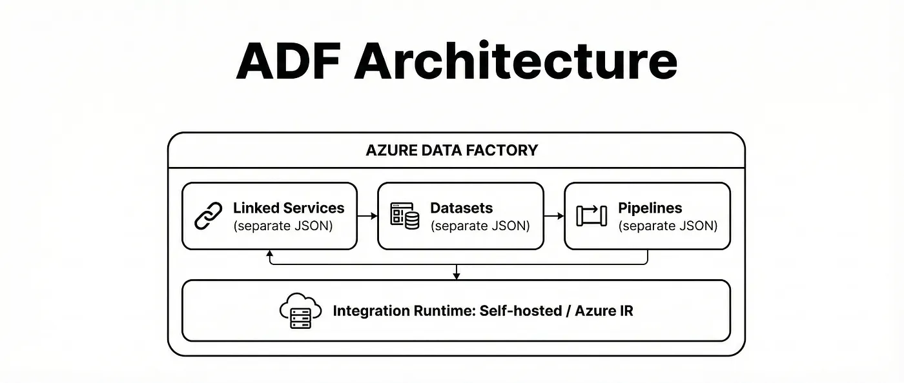
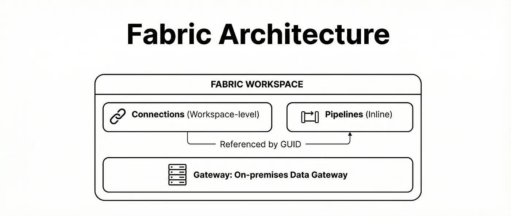
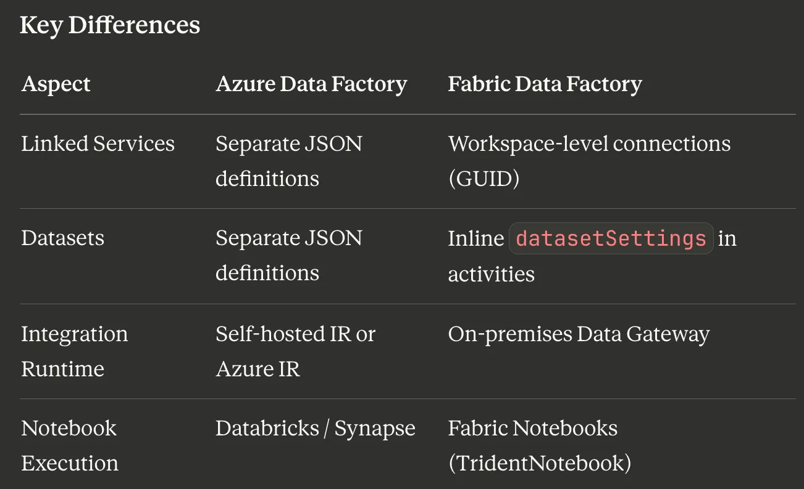

# OneLake

## OneLake vs ADLS Shortcuts

Reference: https://medium.com/@kocyigityasar/migrating-metadata-driven-pipelines-from-azure-data-factory-to-microsoft-fabric-39ddf38c6e7f

𝗢𝗻𝗲𝗟𝗮𝗸𝗲 𝘃𝘀 𝗔𝗗𝗟𝗦  which storage approach should you use, when, and why?

A shortcut is essentially a symbolic link in OneLake: you expose data in a new location without copying it. Sounds simple, but the type of shortcut you choose can change everything.

𝗜’𝗹𝗹 𝗯𝗲 𝗿𝗲𝘃𝗶𝗲𝘄𝗶𝗻𝗴 𝟮 𝗼𝗽𝘁𝗶𝗼𝗻𝘀:

① 𝗢𝗻𝗲𝗟𝗮𝗸𝗲 𝗦𝗵𝗼𝗿𝘁𝗰𝘂𝘁 (𝗶𝗻𝘁𝗲𝗿𝗻𝗮𝗹)
• Points to data already inside Fabric/OneLake (Lakehouse, Warehouse, KQL DB, etc.)
• Great for reuse across workspaces/domains
• Minimal setup since everything stays inside the Fabric security + storage boundary

② 𝗔𝗗𝗟𝗦 𝗚𝗲𝗻𝟮 𝗦𝗵𝗼𝗿𝘁𝗰𝘂𝘁 (𝗲𝘅𝘁𝗲𝗿𝗻𝗮𝗹)
• Points to data that stays in your own ADLS Gen2 account (often Databricks Delta tables)
• Best for hybrid setups: keep ADLS as the source of truth, surface it in Fabric for analytics

• 𝗕𝗶𝗴 𝗴𝗼𝘁𝗰𝗵𝗮: access is typically delegated via the configured connection/credential so governance and ownership must be designed intentionally

If you’re running Direct Lake or building high-concurrency semantic models, your shortcut choice can impact security boundaries, performance patterns, and operational ownership. Worth getting right early.

Are you using shortcuts mainly for reuse across workspaces, or to bridge existing ADLS/Databricks lakes into Fabric?

### ADF Architectire

### Fabric Architecture

### Key Differences
