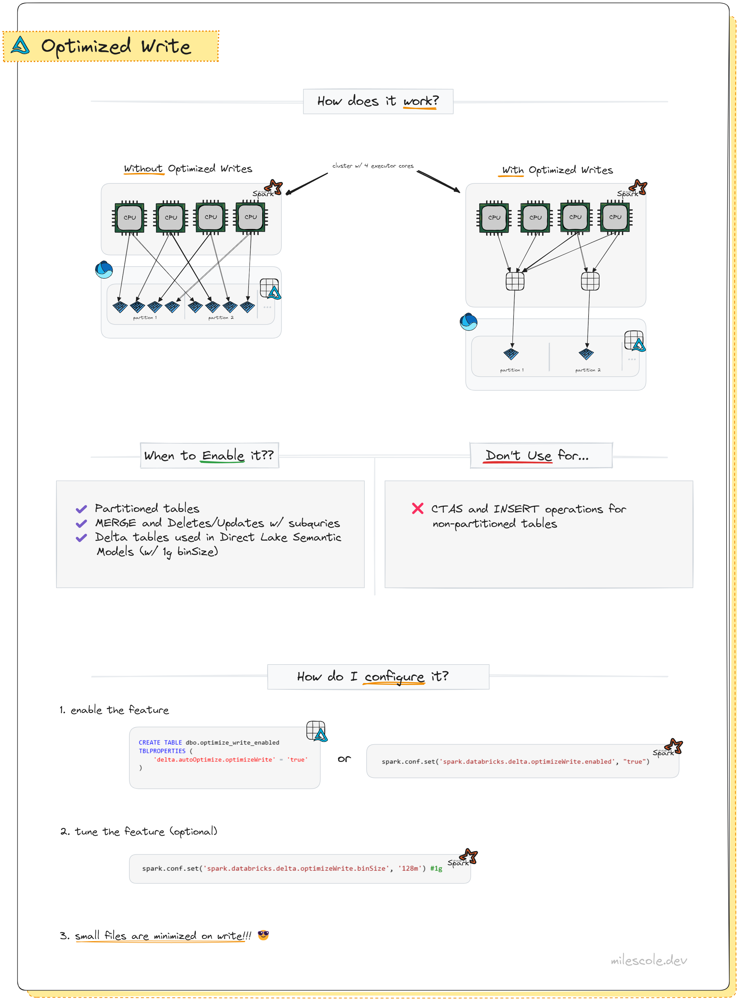

# Optimized Write

In short: `spark.databricks.delta.optimizeWrite.enabled` tells Spark to shuffle data before writing it to disk. This ensures that you write a small number of large files (efficient) rather than a large number of tiny files (inefficient). **The Optimized Write feature is designed with partitioned tables in mind. **

> If leaving Optimized Write enabled, you may want to change the BinSize to 256MB or even 128MB depending on your workload. `spark.databricks.delta.optimizeWrite.binSize`. This is set in bytes.

## 1. The Problem: "Small Files"

Without this setting, Spark writes data based on how it is currently distributed across the cluster's executors.

- Scenario: You are writing data partitioned by date.
- Result: If 100 executors all have a tiny piece of data for date=2024-01-01, they will all open a separate file in that partition folder and write their tiny piece.
- Outcome: You end up with 100 tiny files for that one day. This ruins read performance ("The Small File Problem").

## 2. The Solution: Optimized Write

When you set `spark.databricks.delta.optimizeWrite.enabled = true`:

- Shuffle: Spark **forces a shuffle operation before the write phase**.
- Group: It groups the data for date=2024-01-01 onto a single executor (or as few as possible).
- Write: That single executor writes one large file (target size is usually 128MB) instead of 100 tiny ones.

## 3. Pros and Cons

| Feature | Impact |
|---| --|
| Read Speed | High. Reads become much faster because the query engine opens fewer files. |
| Write Speed | Lower. Writes take longer because the extra shuffle step requires CPU and network usage.|
| Storage | Efficient. Reduces metadata overhead and improves compression. |
| Maintenance | Low. Reduces the need to run the expensive OPTIMIZE command manually.|

## 3. How to use it
You can enable this feature in two ways:

1. Session Level (Global for the notebook/job) Use this if you want all writes in your current job to use optimized writes.

`spark.conf.set("spark.databricks.delta.optimizeWrite.enabled", "true")`

2. Table Level (Persistent) Use this if you want to ensure anyone writing to this specific table uses optimized writes, regardless of their session settings.

`ALTER TABLE my_table SET TBLPROPERTIES (delta.autoOptimize.optimizeWrite = true);`

## 4. Summary Recommendation

Enable this setting if:

- You are writing to a Partitioned Table.
- You notice your write generates thousands of small files (KB or low MB size).
- You value Read Performance over Write Latency.
- In Fabric, Optimized Write is important for optimizing Power BI Direct Lake Semantic Model performance. Considering that this feature results in consolidating data into less files (targeted based on the size of data in-memory), outside of Spark, this feature can be useful for writing out Delta tables for other engines that might be optimized when reading less files. **A prime example of this is Power BI Direct Lake Semantic Models: cold cache Direct Lake queries are fastest on average when reading from Delta tables where Optimized Write was enabled with a 1GB bin size.** This is why the default Spark config in Fabric uses 1GB as the bin size.